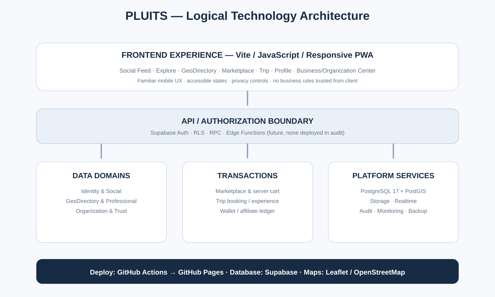

# PLUITS — Business, Product & Technology Blueprint
**Versi:** 1.0 · **Tanggal:** 9 November 2026  
**Tujuan:** menerjemahkan narasi founder dan model bisnis ke journey, algoritma, domain backend, frontend, tata kelola, serta acceptance criteria.

## 1. Prinsip turunan
Urutan desain PLUITS adalah: masalah manusia → cerita pengguna → dampak pihak terkait → proposisi nilai → model bisnis → perilaku dan journey → algoritma → kontrak backend → UI/UX frontend → pengujian → rollout.

Cerita Ibu Nia bukan contoh pemasaran yang ditempel di depan dokumen. Ia adalah persona pengarah untuk menguji apakah produk memberi nilai nyata dan tetap mudah digunakan. Persona ini tidak dibatasi pada perempuan, usia, atau kelompok tertentu; ia mewakili pengguna yang sudah akrab dengan Instagram tetapi tidak ingin belajar aplikasi yang rumit.

## 2. Persona dan kebutuhan

**Ibu Nia — pengguna sosial yang praktis**
- Terbiasa dengan Feed, Story, Reels, Like, komentar, follow, dan profil.
- Tidak ingin banyak istilah teknis atau menu sulit ditemukan.
- Ingin berbagi pengalaman, melihat pengalaman orang lain, dan menemukan tempat/produk/layanan.
- Memilih sendiri apakah konten dan aktivitasnya publik, hanya untuk pengikut, atau privat.
- Tidak wajib bertransaksi agar dapat menikmati PLUITS.

**Pengguna lokal:** mencari toko, layanan, fasilitas, organisasi, dan informasi di sekitar; membutuhkan lokasi yang benar dan pilihan fulfillment yang jelas.

**Penyedia/bisnis:** membutuhkan profil resmi, katalog, harga, ketersediaan, pelanggan, transaksi, laporan, staf, dan ekspor data.

**Profesional:** membutuhkan identitas, portofolio, spesialisasi, tempat praktik/kerja, afiliasi organisasi, dan bukti hubungan profesional.

**Organisasi/komunitas/lembaga publik:** membutuhkan profil, pengelola berwenang, pengumuman, kegiatan, partisipasi, kontribusi akuntabel, dan kanal informasi.

## 3. Journey inti

### Journey A — Ibu Nia berbagi pengalaman
1. Buka aplikasi → Feed familiar.
2. Lihat Story/Reels/postingan.
3. Buat foto/video, caption, dan pilih audiens.
4. Opsional: tautkan tempat, penyedia, produk, layanan, atau transaksi.
5. Sistem memeriksa hubungan dan status bukti yang sah.
6. Post terbit pada waktu publikasi saat ini.
7. Detail pengalaman dapat menampilkan waktu kejadian secara terpisah jika sumbernya valid.
8. Pengguna dapat mengelola konten sosialnya; fakta transaksi tidak dapat diubah melalui caption.

**Acceptance:** pengguna baru memahami cara melihat, membuat, menyukai, berkomentar, mengikuti, dan membagikan konten tanpa tutorial teknis panjang; privasi dan label bukti jelas.

### Journey B — pengikut menemukan toko dari cerita
1. Pengikut melihat konten Ibu Nia.
2. Menekan tag toko/produk atau membuka detail pengalaman.
3. Melihat identitas penyedia, tipe penjual, lokasi, katalog, harga, stok/ketersediaan, jam, dan fulfillment.
4. Membandingkan pilihan yang relevan.
5. Sistem memeriksa wilayah layanan dan kapasitas.
6. Pengguna memilih pengantaran lokal atau pickup jika tersedia.
7. Backend menghitung ulang harga/stok/fulfillment saat checkout.
8. Order dan status pemenuhan tercatat.

**Acceptance:** backend menolak checkout di luar cakupan; harga dan stok tidak dipercaya dari client; cart/order mengikuti aturan satu toko per order yang berlaku.

### Journey C — GeoDirectory dan klaim tempat
1. Pengguna menjelajah peta atau daftar.
2. Melihat status sumber tercatat, belum diklaim, klaim diajukan, dikelola, atau terverifikasi.
3. Pengelola mengajukan klaim dengan bukti kewenangan.
4. Sistem mendeteksi klaim terbuka/duplikasi dan mengarahkan ke pemeriksaan.
5. Reviewer memeriksa bukti, hubungan pemohon, lokasi, dan sengketa.
6. Persetujuan memberi role yang sesuai; penolakan memiliki alasan dan jalur banding.
7. Laporan pengguna menjadi sinyal pemeriksaan, bukan penghapusan otomatis.
8. Jika klaim dicabut, akses yang berasal dari klaim ikut dicabut dan audit trail tersimpan.

**Acceptance:** tidak ada user memperoleh hak owner hanya karena mengetuk tombol klaim; cross-account dan unauthorized claim tests lulus.

### Journey D — organisasi dan kontribusi
1. Organisasi terdaftar sebagai entitas dengan identitas dan lokasi yang sesuai.
2. Pihak berwenang mengklaim/mengelola profil melalui verifikasi.
3. Pengelola menerbitkan pengumuman atau kegiatan.
4. Pengguna melihatnya melalui Feed, Explore, atau profil organisasi.
5. Jika mekanisme kontribusi telah disetujui dan siap, pengguna dapat berkontribusi dengan persetujuan jelas.
6. Ledger organisasi mencatat dana masuk, status, biaya, refund, dan penggunaan.
7. Pengelola menerbitkan ringkasan pertanggungjawaban.

**Acceptance:** dana organisasi terpisah dari saldo personal; transaksi direkonsiliasi; role pengelola dan audit jelas. Tidak ada uang sungguhan sebelum legal/payment readiness.

### Journey E — profesional dan peluang kerja
1. Pengguna mengisi profil profesional dan portofolio.
2. Organisasi mengonfirmasi afiliasi sesuai kewenangan.
3. Perusahaan/lembaga menerbitkan lowongan atau kebutuhan tenaga.
4. Pengguna menemukan peluang berdasarkan lokasi, keahlian, dan preferensi yang dipilih.
5. Lamaran dan komunikasi berlangsung sesuai privasi dan persetujuan.

**Acceptance:** afiliasi tidak bisa diklaim sepihak; lowongan memiliki penerbit sah; data lamaran tidak menjadi konten publik otomatis.

## 4. Pengalaman frontend — familiar first, more value second

### Pola interaksi
- Feed visual sebagai layar awal.
- Stories horizontal dan akses video/Reels yang mudah ditemukan.
- Composer sederhana untuk foto/video, caption, audiens, dan tag.
- Like, komentar, share, save, follow, dan menu post konsisten.
- Profil dengan tab konten dan bagian profesional sesuai pilihan pengguna.
- Explore/Search untuk menemukan orang, bisnis, tempat, produk, organisasi, dan layanan.
- GeoDirectory sebagai map/list switch yang dapat digeser, dengan filter sederhana.
- Business/Organization Center dipisahkan dari navigasi konsumen agar tidak membebani Ibu Nia.
- Konteks transaksi muncul saat relevan, bukan memaksa semua posting menjadi commerce.

### Aturan UX
1. Satu layar memiliki satu tujuan utama.
2. Istilah sederhana dan label jelas.
3. Aksi utama mudah ditemukan dengan jempol.
4. Loading, kosong, gagal, sukses, dan retry harus dirancang.
5. Minta izin GPS hanya ketika pengguna memilih lokasi; sediakan pilihan manual.
6. Jangan meminta pengguna memahami ledger, RLS, status klaim internal, atau istilah database.
7. Aksesibilitas: ukuran teks, kontras, touch target, keyboard, screen reader, dan bahasa.
8. Jangan menyalin brand assets atau detail desain proprietary Instagram; gunakan pola interaksi umum yang familier.

## 5. Keluarga algoritma — dipisah sesuai tujuan

### A. Social Feed Ranking
Tujuan: menyajikan konten/orang yang relevan tanpa menjadikan engagement mentah sebagai satu-satunya tujuan. Sinyal: hubungan follow, interaksi disengaja, minat eksplisit, freshness, diversity, kualitas konten, feedback hide/not interested, safety, dan pilihan Following/For You. Hindari engagement bait, diskriminasi atribut sensitif, promosi tersembunyi, dan popularitas sebagai satu-satunya ranking.

### B. GeoDirectory / Local Discovery Ranking
Tujuan: menemukan entitas yang relevan di area pilihan. Urutan: status publikasi → tipe/kategori → area/radius → ketersediaan/operasional → status data/verifikasi → jarak → minat/feedback → diversity. Map dan list memakai candidate set konsisten. Unclaimed tidak sama dengan verified. Sponsor diberi label.

### C. Search Ranking
Tujuan: memahami kata yang dicari dan menampilkan penyedia yang sesuai, bukan akun yang membayar. Sinyal: relevansi teks/kategori, lokasi, tipe provider, stok/availability, harga/ketentuan, jarak, status verifikasi, kualitas data, dan fulfillment. Seller type transparan; reseller tidak otomatis dilarang jika relasi dan haknya jelas.

### D. Economic Attribution
Tujuan: menentukan sumber referral/affiliate dan komisi atas transaksi yang memenuhi syarat. Syarat: attribution window, referral record, order paid/completed, cancellation/refund handling, commission rate, hold, settlement, payout, idempotency, fraud detection, dispute, dan audit ledger. View, like, click, atau unpaid order bukan komisi earned.

### E. Trust & Integrity Signals
Tujuan: menjaga kualitas entitas, klaim, transaksi, dan konten. Sinyal: provenance, claim evidence, duplicate detection, confirmed reports, appeals, history, ownership, verification expiry, reviewer decisions. Laporan bukan vonis.

Algoritma ini saling bertukar sinyal yang diizinkan, tetapi tidak digabung menjadi satu skor universal.

## 6. Backend domains dan data ownership

| Domain | Data inti | Tanggung jawab |
|---|---|---|
| Identity & Auth | auth user, profile, account context | Satu identitas, session, MFA, privacy |
| Social | posts, media, likes, comments, follows, blocks, messages, notifications | Konten dan relasi sosial |
| GeoDirectory | entities, categories, locations, sources, claims, memberships, relationships, media | Identitas tempat/entitas dan provenance |
| Professional | professional profiles, portfolio, verification, affiliations | Keahlian dan hubungan kerja |
| Organization | organization profile, stewards, branches, announcements, events | Tata kelola organisasi |
| Marketplace | stores, products, variants, stock, cart, orders, payments, fulfillment | Perdagangan lokal |
| Trip | plans, itinerary, service request, booking, visit, experience | Rencana dan perjalanan aktual |
| Business Center | roles, modules, reports, exports, audit | Pengelolaan usaha kategori |
| Wallet/Finance | accounts, ledger, holds, fees, payouts, refunds, reconciliation | Keuangan yang dapat diaudit |
| Affiliate | referral, attribution, commission, settlement | Komisi kreator |
| Hiring | job posts, applications, employer authority | Peluang kerja |
| Trust & Safety | reports, moderation, appeals, disputes, audit | Keamanan dan sengketa |

Organization, Affiliate, Hiring, donation ledger, dan sebagian booking lifecycle adalah kebutuhan rancangan masa depan; jangan menganggapnya sudah ada hanya karena ada tabel directory atau wallet.

## 7. Kontrak data penting
- Feed post menyimpan published_at; activity/transaction event menyimpan occurred_at dari sumber sah.
- GeoDirectory entity mempunyai satu ID kanonis; store/provider, social post, Trip, event, dan organisasi merujuk ke ID yang sama jika tepat.
- Source provenance menyimpan sumber, lisensi, waktu impor/pembaruan, dan confidence.
- Claim menyimpan pemohon, bukti, reviewer, status, alasan, dan audit.
- Organization membership menyimpan role, permission, granted_by, status, dan masa berlaku.
- Cart/order menyimpan snapshot item, harga, biaya, fulfillment, dan status authoritative di server.
- Wallet memakai append-only ledger; saldo adalah hasil perhitungan entry, bukan angka yang dapat diubah client.
- Affiliate commission terkait event order yang memenuhi syarat; reversal memakai entry lawan, bukan menghapus sejarah.
- Alamat privat, identitas, perjalanan privat, chat, dan dokumen legal tidak boleh masuk ke public feed/query.

## 8. Teknologi — kondisi sekarang vs target

**Kondisi terverifikasi**
- Frontend: Vite + JavaScript ES modules + CSS.
- Backend: Supabase Auth, PostgreSQL 17, RLS, RPC, Storage, Realtime.
- Geo: PostGIS di schema extensions, Leaflet, OpenStreetMap.
- Deployment: GitHub Actions, npm ci, production-surface test, Vite build, GitHub Pages.
- PWA: manifest dan service worker tersedia.
- Edge Functions: belum ada yang deployed pada audit ini.

**Prinsip target**
- Pertahankan stack selama memadai; hindari rewrite tanpa alasan.
- Pusatkan konfigurasi Supabase/client, error handling, telemetry, dan design tokens.
- Backend/RLS menjadi sumber kebenaran untuk authorization, harga, stok, claim, status transaksi, wallet, dan komisi.
- Pertimbangkan Edge Functions untuk proses server-side yang memerlukan secret/integrasi eksternal; jangan expose service-role key ke browser.
- Pilih payment provider, email/push/WhatsApp, POS, dan native wrapper setelah analisis kebutuhan dan biaya.
- Map data harus dari sumber berlisensi/diizinkan; jangan scrape database Google Maps.
- PWA saat ini bukan bukti Play Store packaging dan region gate sudah siap.

## 9. Security & privacy gates
1. RLS pada semua tabel exposed; policy diuji untuk anon, owner, staff, unrelated user, revoked user.
2. Review semua SECURITY DEFINER: function body, search_path, grants, auth.uid checks, authorization matrix, idempotency, negative tests.
3. Aktifkan leaked-password protection setelah konfigurasi dan dampaknya diperiksa.
4. Data sensitif diminimalkan dan akses berbasis kebutuhan.
5. Storage policy menguji ownership, MIME, path, visibility, signed URL, delete, dan upload retry.
6. MFA untuk tindakan berisiko tinggi; session/token lifecycle jelas.
7. Audit trail untuk claims, role, payouts, refunds, moderation, organization stewardship.
8. Rate limits, anti-spam, fraud, abuse reporting, human review, and appeal.
9. Backup/restore dan incident response diuji.
10. Wallet/donasi/affiliate tidak memproses uang sungguhan sebelum legal, ledger, reconciliation, payment, payout, and operations gates lulus.

## 10. Dependency dan prioritas
1. Social First Release + founder UAT.
2. GeoDirectory data quality, claims, reports, disputes, and regional admin.
3. Identity/professional/org roles.
4. Business Center and provider readiness.
5. Server-side cart and reliable local commerce lifecycle.
6. Trip booking/experience lifecycle.
7. Wallet/affiliate/donation ledger after finance/legal design.
8. Hiring/public-service workflows.
9. Regional expansion.

## 11. Acceptance gates
Setiap fitur melewati: DECIDED → SPECIFIED → IMPLEMENTED → DEPLOYED → TESTED → ACCEPTED. Uji minimum: Android mobile, koneksi lambat, privacy, dua akun, unauthorized role, negative cases, refresh persistence, upload failure/retry, dan rollback. Founder UAT adalah keputusan founder; build sukses bukan acceptance.

## 12. Visual references
- [Ecosystem map](./visuals/01-pluits-ecosystem.svg)
- [Ibu Nia journey](./visuals/02-ibu-nia-journey.svg)
- [GeoDirectory trust flow](./visuals/03-geodirectory-trust-flow.svg)
- [Mobile social feed mockup](./visuals/04-mobile-social-feed-mockup.svg)
- [System architecture](./visuals/05-system-architecture.svg)
- [Phased roadmap](./visuals/06-roadmap.svg)
