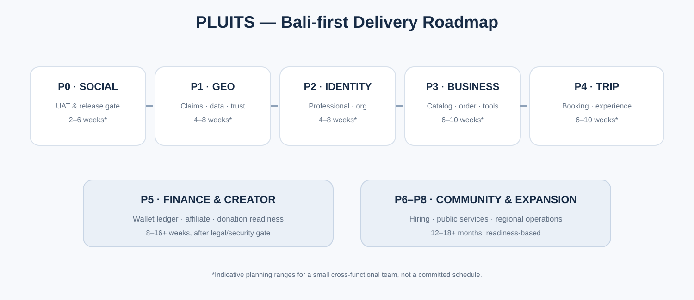

# PLUITS — Audit Repository, Backend & Roadmap
**Tanggal pemeriksaan:** 9 November 2026  
**Repository:** baguskristiansianturi/pluits · branch main  
**Head yang diperiksa:** 7831da1d3f3bb44d12c718a7d92dcf305709cf0a  
**Supabase:** ytndswhqxayqpftszwfh · ap-southeast-1 · PostgreSQL 17.11  
**Sifat audit:** read-only; tidak mengubah schema, data produksi, Auth setting, atau deployment.

## 1. Executive summary
PLUITS memiliki fondasi produk dan backend untuk akun personal, sosial, direktori geografis, klaim dan membership, profil profesional, portofolio, Marketplace, Trip, messaging, moderation, dan wallet scaffold. Namun banyak domain belum mencapai alur end-to-end atau UAT.

Prioritas delivery tetap Social First Release sampai founder menyatakan lulus UAT. Model bisnis yang diperluas tidak berarti semua domain masa depan harus dibangun sekaligus.

## 2. Bukti repository
- Branch kerja: main.
- Head commit terakhir yang diperiksa: 7831da1d3f3bb44d12c718a7d92dcf305709cf0a.
- Frontend entry: src/main.js.
- Router: src/app/router.js.
- Homepage sosial: src/pages/home/index.js.
- Akun sosial: src/pages/account/index.js.
- GeoDirectory: src/pages/directory/index.js.
- Marketplace: src/pages/marketplace/index.js.
- Trip: src/pages/trip/index.js.
- Messages: src/pages/messages/index.js.
- Seller Center: src/pages/seller/index.js.
- Build tool: Vite 8.3.x; package manifest menjalankan npm test melalui scripts/verify-production-surface.mjs.
- Workflow: .github/workflows/deploy.yml; npm ci → npm test → npm run build → verifikasi dist/index.html → deploy GitHub Pages.
- PWA manifest dan service worker direferensikan oleh index.html/main.js.

Commit status check pada head yang diperiksa tidak memberikan status checks. Karena itu audit ini tidak menyatakan Pages deploy terbaru sukses. Perubahan dokumen saja tidak membuktikan frontend atau Android UAT.

## 3. Bukti frontend dan gap

| Area | Bukti kode | Kesimpulan |
|---|---|---|
| Home | src/pages/home/index.js menampilkan social header, stories shortcuts, feed, nearby section, marketplace/trip entry | Social-first homepage telah ada sebagai implementasi awal |
| Social navigation | src/components/social/navigation.js | Ada desktop navigation dan mobile navigation; UX perlu diuji dengan target pengguna |
| Account | src/pages/account/index.js | Profil, posting/media, konteks akun, dan pengaturan memiliki implementasi modular |
| GeoDirectory | src/pages/directory/index.js | Leaflet, area fallback, directory_nearby RPC, filter, dan adaptive signals tersedia |
| Marketplace | src/pages/marketplace/index.js | Katalog dan checkout backend; cart menggunakan localStorage |
| Trip | src/pages/trip/index.js | Itinerary dan service request; request bukan confirmed booking |
| Messages | src/pages/messages/index.js | Supabase Realtime dan local outbox; offline messages belum delivered sampai server mengonfirmasi |
| Seller Center | src/pages/seller/index.js | Workspace ada; sebagian copy footer masih menyebut konstruksi dan perlu diselaraskan pada pekerjaan UX berikutnya |

Temuan desain: homepage dan account sudah memakai pola sosial familiar, tetapi ini belum membuktikan Ibu Nia dapat menggunakannya tanpa kebingungan. Android real-device UAT, dua akun, upload video, interaksi, privasi, dan reconnect tetap diperlukan. Beberapa CSS global masih memiliki token warna lama/berbeda; jangan mengganti warna atau keseluruhan UI dalam pekerjaan model bisnis tanpa keputusan desain.

## 4. Supabase live snapshot

| Pemeriksaan | Hasil |
|---|---:|
| Status project | ACTIVE_HEALTHY |
| PostgreSQL | 17.11.0.018 |
| Region | ap-southeast-1 (Singapore) |
| Public base tables | 62 |
| Tables with RLS enabled | 62/62 |
| Migration history | 81 |
| Edge Functions deployed | 0 |
| Security Advisor: authenticated-callable SECURITY DEFINER | 20 warnings |
| Security Advisor: leaked-password protection | 1 warning (disabled) |
| Performance Advisor | 84 unused-index INFO notices |
| Health Advisor | 0 lints |

Migration history adalah 81 entry live. Versi/name harus dibandingkan dengan file migration repository sebelum DDL berikutnya; jumlah yang sama/berbeda saja tidak membuktikan SQL content identik.

### 4.1 Domain yang tampak pada schema
Social: user_profiles, user_posts, post_media, likes/comments/saves/tags, stories, follows, notifications, blocks, reports, conversations/messages.

GeoDirectory: directory_entities, categories, locations, sources, claims, memberships, relationships, media, preferences, activity events, feedback, saved/recent, post links.

Professional: professional_profiles, professional_portfolio_items, profile_verification_cases, account_context_preferences.

Marketplace: stores, staff, products, variants, images, inventory movements, audit logs, orders, order items, payment records, order events.

Trip: trip_itineraries, trip_itinerary_items, trip_service_requests.

Wallet: wallet_accounts dan wallet_requests; belum ada ledger transaksi finansial lengkap.

### 4.2 Gaps penting
- Tidak ada tabel cart di public schema; cart Marketplace masih localStorage.
- Wallet belum memiliki ledger lengkap, payout, reconciliation, dan payment settlement siap produksi.
- Tidak ditemukan domain affiliate attribution/commission.
- Tidak ada Supabase Edge Functions yang deployed.
- Trip service request tidak sama dengan reservasi/booking confirmed.
- Organization stewardship, donations, hiring, public-service workflow, dan regional dispute case management belum terbukti sebagai modul end-to-end.
- GeoDirectory mempunyai core entities/claims/memberships, tetapi cakupan data masih starter set; sumber data dan klaim perlu operasi manusia.
- Status gate pendaftaran hanya Bali belum dibuktikan oleh audit frontend/database ini.

## 5. Keamanan dan operasional
20 warning SECURITY DEFINER yang dapat dieksekusi authenticated bukan bukti otomatis exploit. Setiap fungsi harus diperiksa body, search_path, auth.uid, authorization, grants, input validation, idempotency, dan negative tests. Advisor mencakup fungsi block/unblock, marketplace order/payment/fulfillment, store, trip request, content report, conversation, dan verification.

Leaked-password protection belum aktif. 84 unused-index notices adalah informasi statistik; jangan menghapus index tanpa query workload dan regression evidence.

Semua 62 public tables memiliki RLS enabled. Ini baseline positif, bukan bukti seluruh policy benar. Perlu test matrix anon, owner, staff, unrelated user, revoked staff, private account, dan cross-store/cross-entity.

Sumber peta saat ini Leaflet/OpenStreetMap. GeoDirectory data harus mengikuti lisensi/provenance; jangan menyalin Google Maps database, foto, atau reviews tanpa izin.

## 6. Klasifikasi status
- **IMPLEMENTED (base):** social posts/media, feed, profiles, stories, follows, notifications, messages, directory map/list, claim foundation, Marketplace catalog/order RPC, Trip itinerary/request, Seller Center.
- **NOT TESTED / UAT pending:** Android real-file upload, two-account social, privacy negative tests, Realtime/offline reconnect, live auth settings, full staff role tests, claim dispute workflow, real business onboarding, dan founder acceptance.
- **GAP:** server cart, complete booking lifecycle, wallet ledger, affiliate ledger, organization/donation/hiring workflows, regional case management, Edge Functions.
- **NOT VERIFIED:** latest Pages deploy for head commit; Bali-only signup enforcement; operational office/staff readiness; market size, CAC, LTV, unit economics.

## 7. Roadmap yang diturunkan dari model bisnis

| Urutan | Tahap | Deliverable | Gate |
|---|---|---|---|
| P0 | Social First Release | Feed, Story/Reels, profile, post, follow, comments, messages, notifications, privacy | Founder UAT dua akun dan Android |
| P1 | GeoDirectory Trust Bali | Canonical entity, licensed data, claim, verification, report, dispute, appeal, local ops | Claim abuse/negative tests dan data quality |
| P2 | Identity & Organization | Professional profile, portfolio, affiliations, organization roles, branch, announcement | Verified stewardship and privacy |
| P3 | Business Center | Category modules, staff permissions, catalog, orders, reports, exports | Staff authorization + merchant UAT |
| P4 | Local Commerce | Server cart, fulfillment, payment lifecycle, refunds, support | Transaction reconciliation and local fulfillment |
| P5 | Trip | Booking/calendar/availability, actual visit/service evidence, Trip timeline | Booking lifecycle and proof semantics |
| P6 | Finance & Creator | Wallet ledger, affiliate attribution, commission, payout, donation ledger | Legal, payment, ledger, fraud and reconciliation |
| P7 | Local community/public services | Banjar, religious institutions, schools, public agencies, hiring | Formal authority and operational readiness |
| P8 | Expansion | New city/region URL and service operations | Regional SLA, provider density, support and dispute capacity |

## 8. Estimasi durasi indikatif
Asumsi: tim kecil 3–5 orang lintas fungsi (product/design, frontend/backend, QA/operations), dengan founder menyediakan keputusan dan UAT. Ini bukan komitmen jadwal.
- P0 Social hardening + UAT: 2–6 minggu, bergantung temuan.
- P1 GeoDirectory trust Bali: 4–8 minggu setelah P0 gate.
- P2 identity/organization MVP: 4–8 minggu.
- P3 Business Center and local commerce hardening: 6–10 minggu.
- P4 Trip lifecycle: 6–10 minggu.
- P5 finance/affiliate/donation readiness: 8–16+ minggu, sangat bergantung legal/provider/security.
- P6 public/community and hiring: 6–12 minggu.
- P7 expansion per city: discovery 2–4 minggu per region, lalu rollout bertahap.

Dengan overlap terbatas, target perencanaan keseluruhan untuk ekosistem Bali yang matang dapat berada di kisaran 9–18 bulan atau lebih. Satu developer saja akan membutuhkan waktu lebih lama. Ini bukan estimasi biaya.

## 9. Data yang dibutuhkan untuk budget dan ROI
1. Team plan dan monthly compensation per role.
2. Hosting, Supabase, storage, bandwidth, maps/geocoding, email/push, payment, monitoring.
3. User acquisition and merchant acquisition cost.
4. Volume order/booking, average order value, take rate, payment fees, refunds, fraud.
5. Support/moderation/dispute case volume and cost.
6. Regional office/staff trigger, lease, equipment, travel, and local compliance.
7. Revenue mix by category and SaaS package.
8. Tax, legal, licenses, contracts, and insurance.
9. Conservative/base/aggressive model, runway, break-even, ROI, and sensitivity.

Tidak ada biaya, market size, revenue forecast, atau ROI yang dimasukkan tanpa data tersebut.

## 10. Risiko prioritas
- Social adoption tidak terbukti sampai UAT target pengguna.
- GeoDirectory growth tanpa data quality dapat merusak trust.
- Claim disputes dan public organization access memerlukan human review.
- Wallet/donation/affiliate menyangkut uang dan tidak boleh dipercepat tanpa ledger dan compliance.
- Local operations harus disesuaikan dengan volume kasus dan wilayah.
- Pengembangan semua domain sekaligus akan memecah fokus dan memperlambat release.

## 11. Keputusan audit
Audit ini read-only. Tidak ada schema, migration, user data, Auth setting, frontend, atau payment changes. Perubahan model bisnis dan proposal dilakukan terpisah. Social First Release tetap P0 sampai founder UAT diterima.
